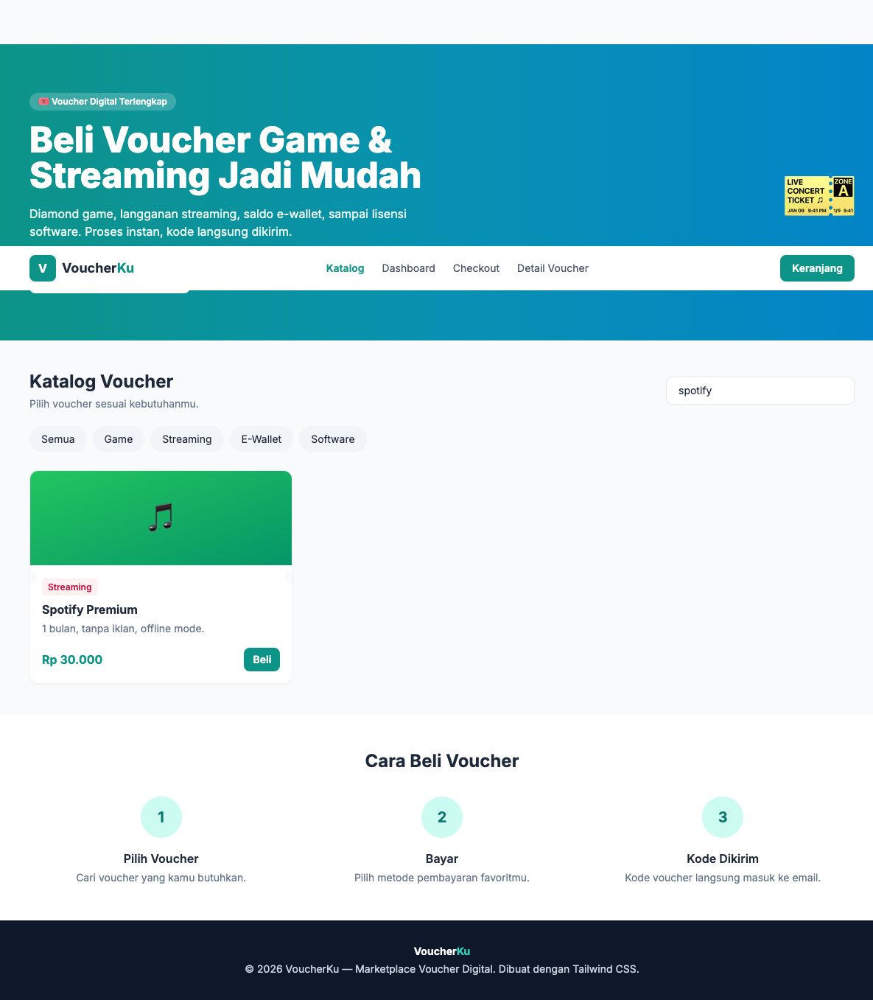
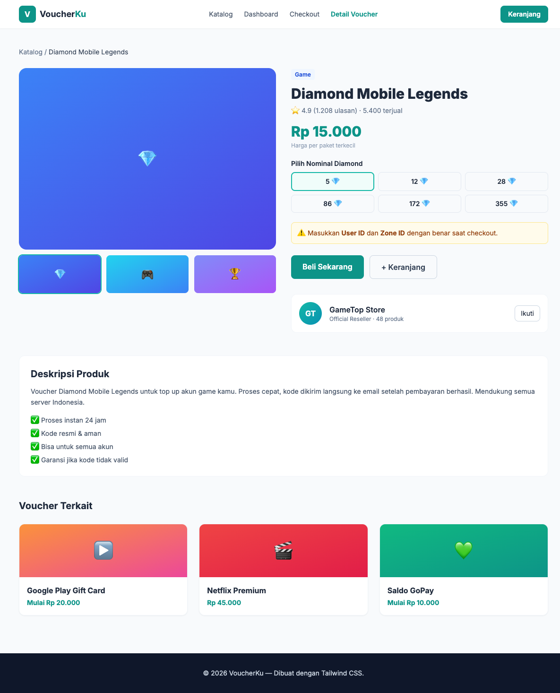
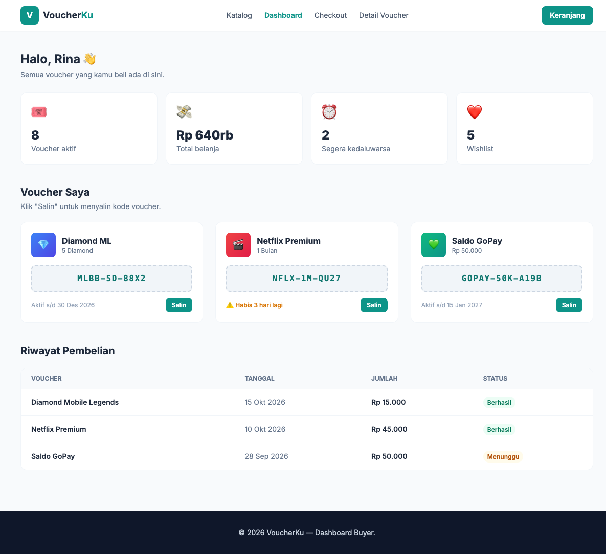
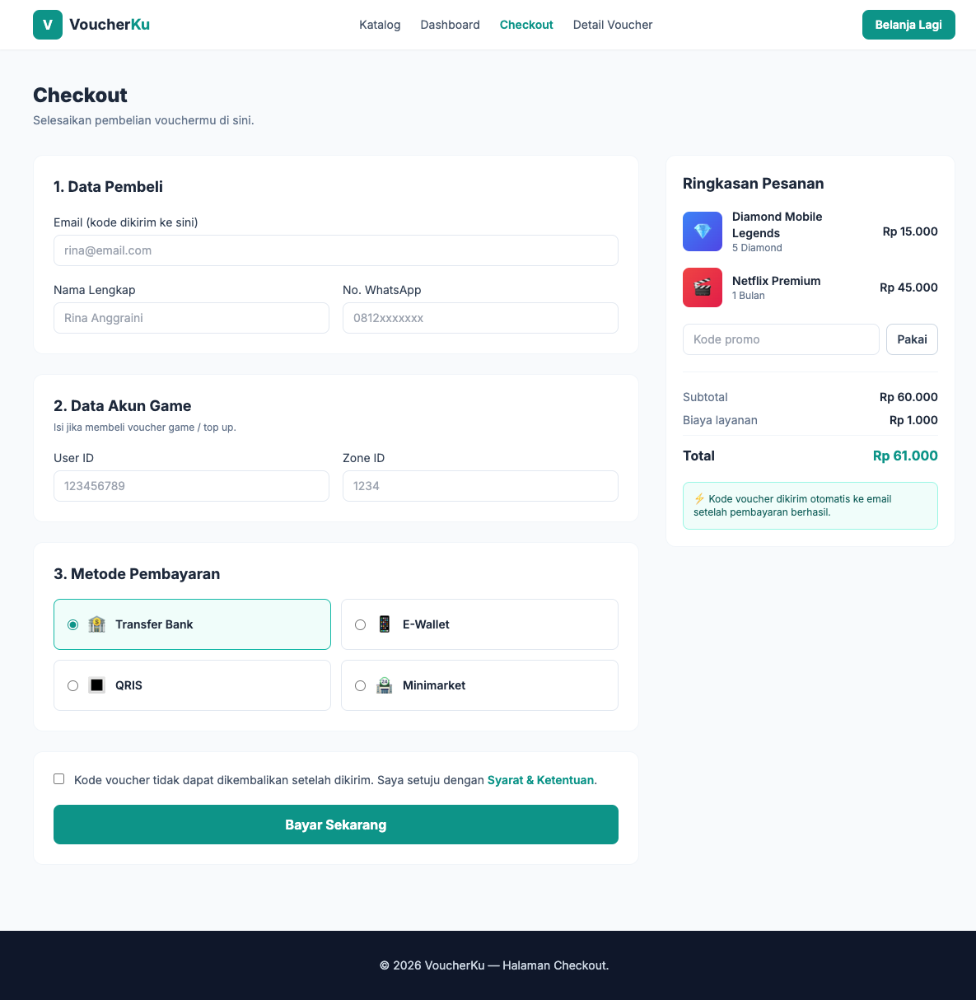

# VoucherKu

Tugas web sederhana, marketplace untuk jual beli voucher digital.
Isinya voucher game, langganan streaming, saldo e-wallet, dan software.

Dibuat pakai HTML dan Tailwind CSS (lewat CDN, jadi gak perlu install).
CSS tambahan ada di style.css.

## Halaman

- index.html : katalog voucher
- product.html : detail voucher, ada pilihan nominal
- dashboard.html : dashboard pembeli, ada voucher yang sudah dibeli
- checkout.html : halaman pembayaran

## Struktur file

    voucherku/
      index.html
      product.html
      dashboard.html
      checkout.html
      style.css
      assets/
        screenshots/

## Catatan

- Ini gak pakai JavaScript, cuma HTML dan CSS.
- Menu di HP (tombol ☰) buka tutupnya pakai trik checkbox di CSS.
- Kotak cari dan kategorinya baru tampilan doang, belum jalan.
- Di HP tampil 1 kolom, tablet 2 kolom, komputer 3 kolom. Itu diatur dari
  class Tailwind grid-cols-1 sm:grid-cols-2 lg:grid-cols-3.

## Screenshot

Katalog:

Detail voucher:

Dashboard:

Checkout:

